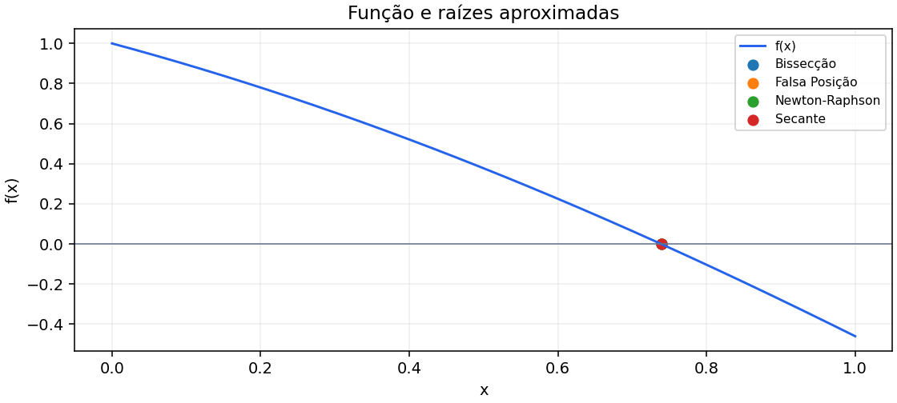
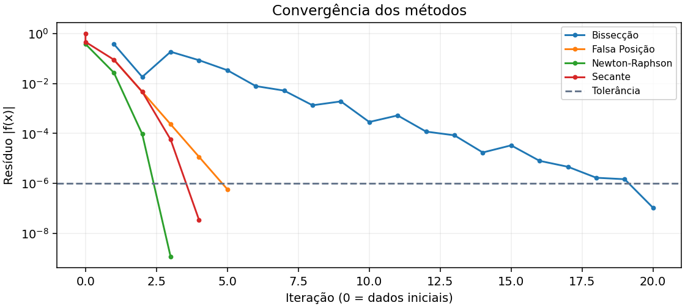
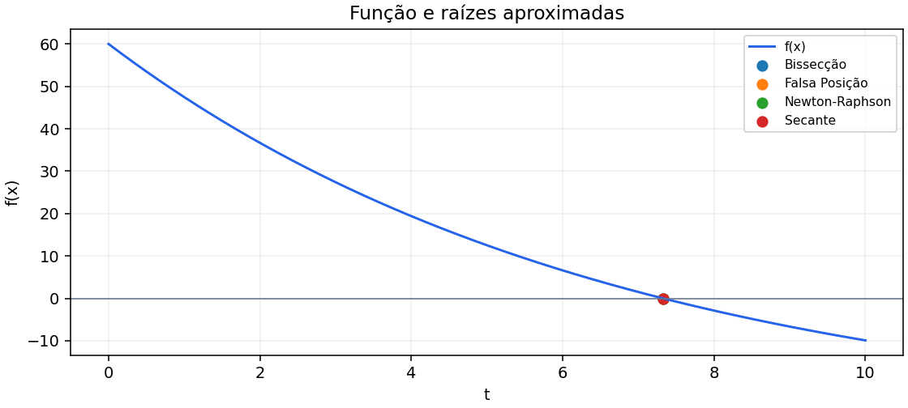
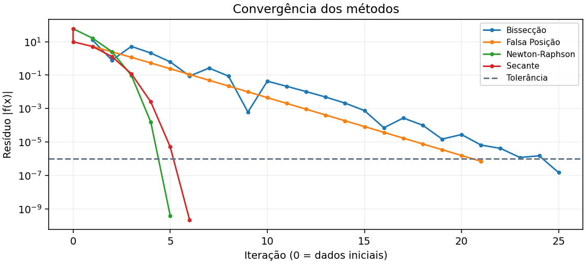
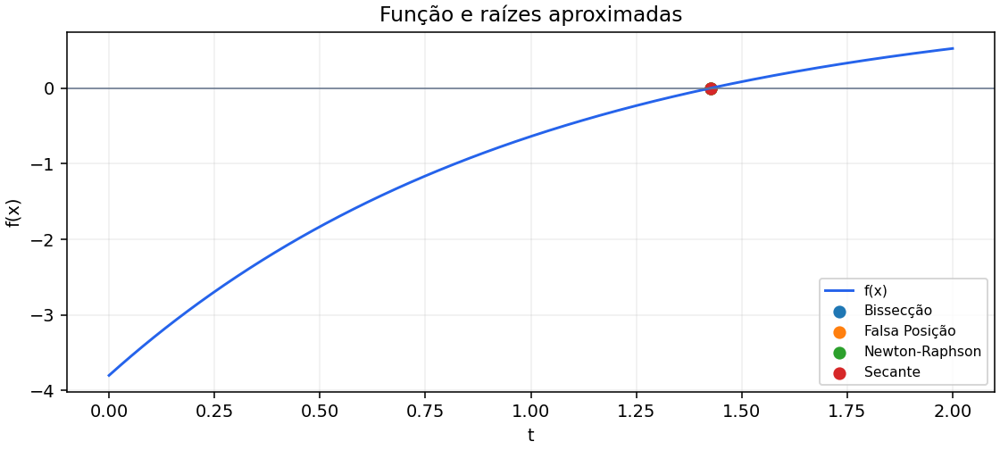
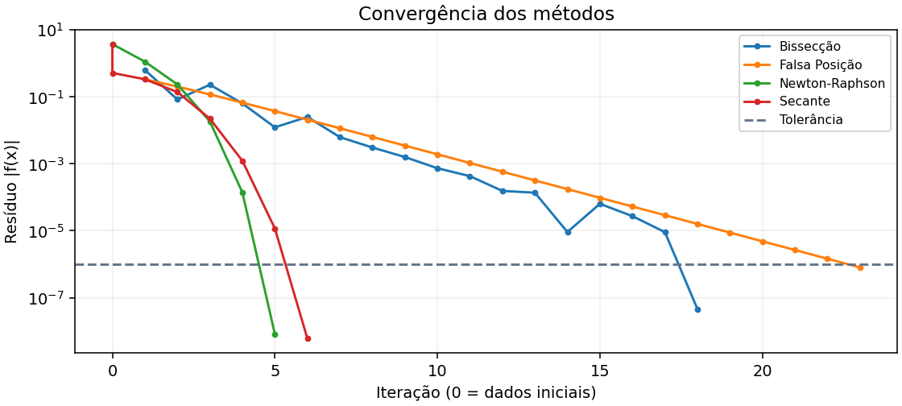

## Comparativo de métodos para zeros de funções

Cálculo Numérico — Unidade 1 — 2026.2

VERSÃO PARA REVISÃO: preencher nomes e contribuições reais em report/equipe.json e gerar novamente antes da entrega.

## Programa e execução

O simulador implementa Bissecção, Falsa Posição clássica, Newton-Raphson e Secante em Python. A interface Streamlit aceita funções personalizadas, estimativas, tolerância e limite de iterações. Apresenta tabela, gráficos, histórico e exportação CSV/JSON. O interpretador de expressões permite apenas operações matemáticas autorizadas, sem executar código Python arbitrário.

Instale as dependências de requirements.txt em um ambiente virtual Python 3.13, conforme o README. Na pasta do projeto: python -m streamlit run app.py. Abra o endereço local apresentado, escolha um exemplo e clique em Comparar métodos. Para novos cálculos, altere as entradas e execute novamente; para encerrar, feche a aba e use Ctrl+C no terminal. Testes: python -m unittest discover -s tests -v. Relatório: python -m report.gerar.

## Métodos e condições de convergência

Bissecção: c=(a+b)/2, conservando a metade com mudança de sinal. Falsa Posição: c=(a f(b)-b f(a))/(f(b)-f(a)), conservando o subintervalo com mudança de sinal. Ambos pressupõem continuidade. A verificação dos sinais não comprova essa hipótese. A implementação da Falsa Posição usa uma expressão equivalente com pesos normalizados para evitar overflow.

Newton: x seguinte = x - f(x)/f'(x). Secante: x seguinte = x1 - f(x1)(x1-x0)/(f(x1)-f(x0)). Newton tem convergência local quadrática para uma raiz simples sob as condições usuais de suavidade e estimativa inicial adequada; Secante tem ordem local aproximadamente 1.618. Bissecção é linear e Falsa Posição clássica pode ser lenta. Métodos abertos não garantem permanecer no intervalo.

## Protocolo de comparação

Todos os casos usam |f(x)| < 1e-6 e no máximo 100 iterações. Precisão final é reportada como resíduo, não como garantia de erro absoluto em x. Também é informado o erro frente à referência. Dados iniciais que já satisfazem o critério contam como zero iterações. Cada tentativa de atualização conta uma iteração; as duas sementes da Secante aparecem no histórico na iteração zero.

Tempos em microssegundos são medianas de 31 execuções, após uma execução de aquecimento. A medição usa perf_counter_ns e inclui avaliações e armazenamento do histórico; exclui análise da expressão, interface e gráficos. O JSON inclui cada amostra temporal. A tabela da interface mostra o tempo de uma única execução. Tempos tão curtos dependem do ambiente e não estabelecem um vencedor universal; a análise prioriza convergência, iterações e resíduos.

Ambiente de medição: Python 3.13.15; Linux-6.18.33.2-microsoft-standard-WSL2-x86_64-with-glibc2.42. Gerado em UTC: 2026-10-13T20:21:40.162028+00:00.

## Validação: cos(x) − x

f = cos(x)-x; derivada = -sin(x)-1. Intervalo [0, 1]; Newton x0=0.5; Secante x0=0, x1=1. Referência: 0.739085133215 .

| Método | Raiz | Iter. | Tempo (µs) | \|f(raiz)\| |
|---|---|---|---|---|
| Bissecção | 0.739085197449 | 20 | 41.240 | 1.075e-07 |
| Falsa Posição | 0.739084782449 | 5 | 13.830 | 5.870e-07 |
| Newton-Raphson | 0.739085133921 | 3 | 12.400 | 1.181e-09 |
| Secante | 0.739085112127 | 4 | 10.829 | 3.529e-08 |

Newton convergiu em 3 atualizações, Secante em 4, Falsa Posição em 5 e Bissecção em 20. As estimativas iniciais favorecem os métodos abertos nesta função suave. A derivada -sin(x)-1 não se anula em [0,1]. A Bissecção reduz o intervalo pela metade a cada passo e exige mais atualizações, mas mantém o confinamento da raiz. A referência decimal serve para validação independente.

Erro absoluto frente à referência: Bissecção: 6.423e-08; Falsa Posição: 3.508e-07; Newton-Raphson: 7.056e-10; Secante: 2.109e-08.

Não houve falhas por derivada nula, denominador nulo ou falta de mudança de sinal. Não houve extrapolação do intervalo nesta execução.

## Resfriamento do componente

f = 90*exp(-0.15*t)-30; derivada = -13.5*exp(-0.15*t). Intervalo [0, 10]; Newton x0=0; Secante x0=0, x1=10. Referência: 7.32408192445 min.

| Método | Raiz | Iter. | Tempo (µs) | \|f(raiz)\| |
|---|---|---|---|---|
| Bissecção | 7.32408195734 | 25 | 80.009 | 1.480e-07 |
| Falsa Posição | 7.32408208053 | 21 | 68.719 | 7.023e-07 |
| Newton-Raphson | 7.32408192437 | 5 | 27.739 | 3.966e-10 |
| Secante | 7.3240819245 | 6 | 22.900 | 2.134e-10 |

Newton convergiu em 5 atualizações e Secante em 6, contra 21 da Falsa Posição e 25 da Bissecção. A Falsa Posição conserva uma extremidade por vários passos nesta curva exponencial, limitando seu avanço. Da equação 90 exp(-0.15t)=30 resulta t=ln(3)/0.15, aproximadamente 7.3240819245 minutos. O componente esfria de 110 °C em direção a 20 °C; o instante calculado marca a passagem por 50 °C. A função é estritamente decrescente, portanto essa raiz é única para t >= 0.

Erro absoluto frente à referência: Bissecção: 3.289e-08; Falsa Posição: 1.561e-07; Newton-Raphson: 8.813e-11; Secante: 4.741e-11.

Não houve falhas por derivada nula, denominador nulo ou falta de mudança de sinal. Não houve extrapolação do intervalo nesta execução.

## Carregamento do capacitor

f = 5*(1-exp(-t))-3.8; derivada = 5*exp(-t). Intervalo [0, 2]; Newton x0=0; Secante x0=0, x1=2. Referência: 1.42711635564 s.

| Método | Raiz | Iter. | Tempo (µs) | \|f(raiz)\| |
|---|---|---|---|---|
| Bissecção | 1.42711639404 | 18 | 59.289 | 4.608e-08 |
| Falsa Posição | 1.42711702528 | 23 | 75.169 | 8.036e-07 |
| Newton-Raphson | 1.42711634882 | 5 | 24.710 | 8.179e-09 |
| Secante | 1.42711636068 | 6 | 22.889 | 6.043e-09 |

Newton convergiu em 5 atualizações, Secante em 6, Bissecção em 18 e Falsa Posição em 23. A Falsa Posição clássica foi mais lenta em iterações que a Bissecção: interpolar não garante avanço mais rápido quando uma extremidade permanece fixa. A solução analítica é t=-ln(0.24), aproximadamente 1.4271163556 segundos. O modelo fornecido corresponde à carga até 5 V com constante de tempo de 1 s. O instante de cruzamento de um limiar de tensão permite estudar atrasos em temporizadores, tempo de acomodação de sinais de sensores e decisões de leitura em sistemas embarcados.

Erro absoluto frente à referência: Bissecção: 3.840e-08; Falsa Posição: 6.696e-07; Newton-Raphson: 6.816e-09; Secante: 5.036e-09.

Não houve falhas por derivada nula, denominador nulo ou falta de mudança de sinal. Não houve extrapolação do intervalo nesta execução.

## Análise crítica e limitações

Newton foi o mais eficiente em número de atualizações nos três casos escolhidos. Isso depende de boas estimativas e de uma derivada disponível e correta. Cada atualização de Newton avalia também a derivada, portanto menos iterações não implica automaticamente menor tempo. Secante ofereceu uma alternativa rápida sem derivada. Os métodos de intervalo mantiveram a raiz confinada; a Falsa Posição não superou a Bissecção em todos os exemplos.

As dificuldades tratadas foram distinguir resíduo de erro na raiz, evitar que estagnação fosse considerada sucesso, validar domínio e expressões, e comparar tempos curtos. Os testes exercitam derivada nula, valores iguais na Secante, ausência de mudança de sinal, função indefinida, valores não finitos, limite de iterações, estagnação e extrapolação. Derivadas pequenas não são rejeitadas por um limiar absoluto arbitrário, que dependeria da escala de f; o programa verifica denominador zero, resultados não finitos e convergência.

O programa não comprova continuidade nem correção da derivada fornecida. Os gráficos são amostragens e podem não revelar descontinuidades. O erro em ponto flutuante e estimativas desfavoráveis podem impedir a convergência. A indicação de domínio físico t >= 0 rejeita uma raiz negativa e registra aproximações negativas, sem alterar as fórmulas dos métodos.

## Escopo adotado

O enunciado alterna entre escolher um problema de engenharia e apresentar ambos; foram incluídos os dois e o caso de validação. As menções a truncamento e arredondamento na rubrica parecem pertencer à atividade de propagação de erros: não foi criado um simulador separado desse tema. Os cálculos usam ponto flutuante e apenas a apresentação arredonda os valores.

## Participação dos integrantes

A preencher: Descrever a participação real do integrante.

## Material de referência

Enunciado fornecido da disciplina Cálculo Numérico, Projeto Unidade 1 (Zeros), 2026.2. Os resultados e gráficos foram gerados pelo código deste projeto; consultar README.md para reprodução.
